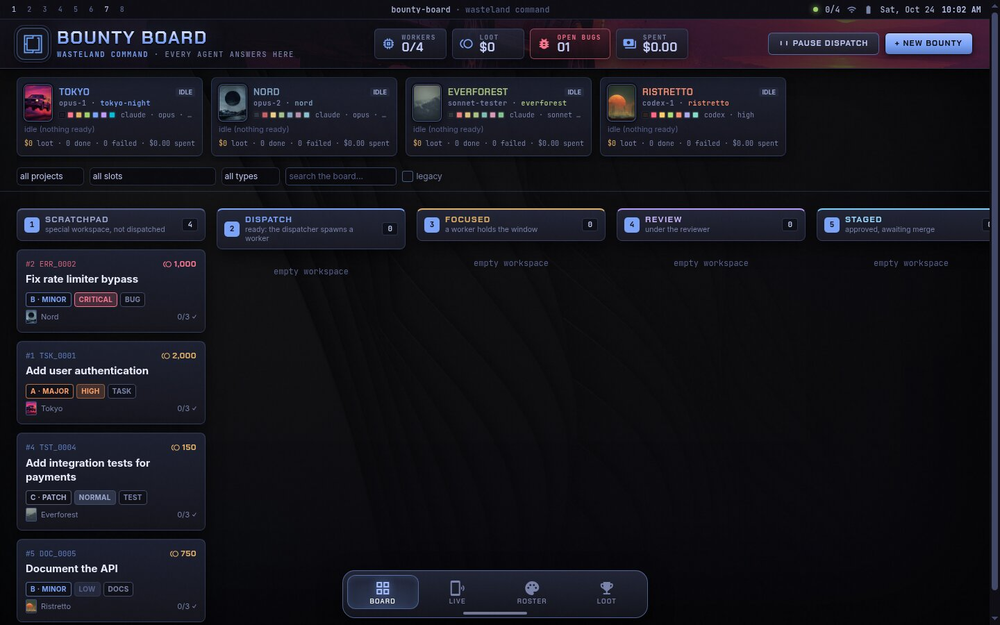
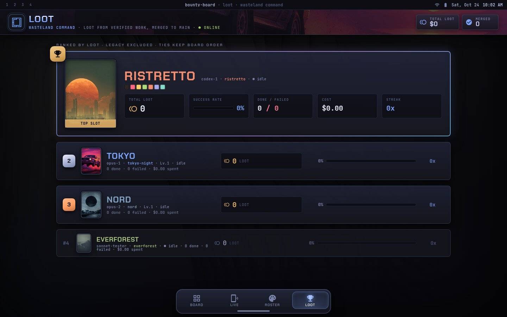

# It's not a Kanban

> **TLDR:** Just tell your AI to clone and set it up and then your next project tell the agent to start a board for it, if it didnt already.

## Why use it

Run a few AI agents in parallel and you hit the same problems fast: they say "done" when nothing landed, they stall silently, they drift off task, and you lose track of who is doing what. A Kanban board just shows you cards. This one makes the agents prove it.

- **"Done" means merged.** A bounty only counts as done when its commits are on main. No more agents claiming work they never shipped.
- **Every submit gets checked.** The branch has to exist, the diff can't be empty, your tests have to pass, and a second model reviews the real diff against your acceptance criteria before anything is approved.
- **Stalled agents get caught.** A watchdog kills workers that go quiet, blocks the bounty with the log attached, and retries on a stronger model.
- **You stop babysitting.** Workers spawn on their own when a bounty is ready, one fresh agent per task, so you plan the work and the board runs it.
- **You can see everything.** A live dashboard shows what every agent is doing, what it costs, and what is stuck.
- **It's fun to watch.** Each project gets its own themed board, and agents earn loot on a leaderboard for verified work only.

AI agent orchestration with teeth. Spawn workers, track bounties, verify work, ship code.

The single accountability system for every AI agent. Work that is not marked done on this board is a known gap. Workers are spawned by the board, one fresh agent per bounty, and a bounty only reaches **done** when its commits are on the project's main branch.





## What it does

- **Auto-dispatch workers**: Claude and Codex agents are spawned automatically when a ready bounty is assigned to an idle slot
- **Full lifecycle**: backlog, ready, in_progress, review, approved, done, plus blocked and failed
- **Watchdog**: kills stalled workers, blocks bounties with the log attached, retries with model escalation (sonnet to opus)
- **Automated code review**: Codex reads the real diff against acceptance criteria; approvals that don't cite evidence are overruled to reject
- **Verification gates**: branch must exist, diff must be non-empty, project's CI/verify command must pass
- **Merge check**: approved bounties auto-complete to done when their commits land on main
- **Live dashboard**: real-time view of what every agent is doing, token usage, cost, lock state, memory
- **Leaderboard**: XP/loot system derived from verified work, streaks, cost tracking
- **CLI**: `bounty` command for everything (add, assign, ready, submit, live, leaderboard, etc.)
- **Themed UIs per project**: each project gets its own styled board, not a shared one
- **Notes to live workers**: send requirements or context to a running agent mid-task
- **External leases**: model machine-wide resource locks (GPU, build locks) visible on the dashboard

## Quick Start

```bash
git clone https://github.com/KewkLW/bounty-board.git
cd bounty-board
cp config/board.example.json config/board.json
# edit config/board.json: set your slots, project, repo path
npm install
npm start
# open http://localhost:3777
```

Set up a project (if you didn't use `seed_project` in config):
```bash
bounty project add my-project \
  --repo /path/to/repo \
  --main main \
  --verify "npm test" \
  --wt-cmd "git worktree add {path} -b {branch} {main}" \
  --wt-path "worktrees/{task}"
```

Add your first bounty:
```bash
bounty add "Fix the login bug" \
  --desc "Users can't log in after password reset" \
  --criteria "Password reset flow completes successfully" \
  --criteria "Existing sessions are preserved" \
  --type bug --tier B --slot opus-1 --ready
```

The dispatcher spawns a fresh Claude worker for opus-1. The worker reads the bounty, writes code, runs tests, and submits. The board verifies, the reviewer checks the diff against your criteria, and once approved and merged, the bounty is done.

## How it works

```
backlog -> ready -> in_progress -> review -> approved -> done
             plus blocked (with a reason) and failed
```

| Step | Who | What the board checks |
|---|---|---|
| backlog to ready | orchestrator (`bounty ready`, UI) | a project, and at least one acceptance criterion |
| ready to in_progress | the worker (`bounty start`) | the dispatcher spawned it for the assigned slot |
| in_progress to review | `bounty submit`, then the gates | the branch exists; its diff against main is not empty; the diff is not only notes/logs (docs and research bounties may be docs-only); the project verify command passes on the branch tip (result and log stored) |
| review to approved / ready | the reviewer (Codex, `codex exec -s read-only`) | reads the real diff and the acceptance criteria; returns approve/reject with per-criterion evidence; an approval that does not show every criterion met is overruled to reject. Reject sends the bounty back to ready with the notes for a fresh worker |
| approved to done | the merge check (every 60 s, or `bounty done`) | every recorded commit is reachable from main (or main holds the same patch: rebase, cherry-pick or squash merges count) |

Work done off the board (an `external` bounty, e.g. one in flight before the board existed) never goes through submit, so it can't reach approved. When the orchestrator has merged it, `bounty close-merged ID --commit SHA [--commit SHA]... ["evidence"]` (API `POST /api/bounties/:id/close-merged {commits, evidence}`) takes it to done from any open status: every commit must exist in the project repo and be an ancestor of main (it is refused otherwise, and refused while the bounty has a live board worker or a verify running). Loot goes to a slot only if that slot's board attempt submitted commits that are on main; otherwise no one is credited. Orchestrator only.

`review`, `approved` and `done` are guarded edges: no request can set them directly. Workers (requests carrying a slot id) can't ready, assign, approve, reject, fail, pause or mark done.

## Setting up AI Workers

### Slot configuration

Slots are your worker capacity. Each slot in `config/board.json` defines an agent that can run one bounty at a time:

```json
{
  "slots": [
    {
      "id": "opus-1",
      "name": "Alpha",
      "runner": "claude",
      "model": "opus",
      "effort": "high"
    },
    {
      "id": "sonnet-scout",
      "name": "Scout",
      "runner": "claude",
      "model": "sonnet",
      "effort": "low"
    },
    {
      "id": "codex-1",
      "name": "Delta",
      "runner": "codex",
      "model": null,
      "effort": "high"
    }
  ]
}
```

Every slot **must** have a unique `name`. The name is the agent's identity for the project's life: it shows on the dashboard, is sent to the telemetry receiver as `agent.name` next to `project`, `bounty.id`, `bounty.slot` and `bounty.attempt`, and appears on the leaderboard. Keep names stable; renaming starts a new series.

The only agents are the dispatcher slots in `config/board.json`. At every start the board runs a re-runnable migration that deletes any agent row not matching a configured slot. An agent row can only be created for a configured slot: `POST /api/agents {id}` and `board.registerAgent` refuse any other id (403), and `GET /api/agents/<non-slot>` is a 404.

Optional fields:
- `bin`: override the CLI binary (e.g. a different Claude account)
- `disabled_until`: ISO timestamp; the slot takes no work until then
- `worktree_root`: build worktrees on a different drive

### Claude workers

Claude workers run:
```
claude -p --output-format stream-json --verbose --model <model> --effort <effort> --allowedTools <tools>
```

Configure the runner in `board.json`:
```json
"runners": {
  "claude": {
    "bin": "claude",
    "allowed_tools": "Bash,Read,Grep,Glob,Edit,Write,MultiEdit,TodoWrite,WebSearch,WebFetch"
  }
}
```

The `allowed_tools` list controls what the Claude agent can do. The board spawns a fresh `claude` process for each bounty attempt.

### Codex workers

Codex workers run `codex exec --json`. Configure the runner:
```json
"runners": {
  "codex": {
    "bin": "codex",
    "args": ["--dangerously-bypass-approvals-and-sandbox"]
  }
}
```

### The worker protocol

Every spawned worker gets a prompt containing the bounty, its acceptance criteria, notes from earlier attempts, project rule docs, and the CLI protocol:

```
bounty start                       # first (prints any waiting orchestrator notes)
bounty inbox                       # unread orchestrator notes, marked read
bounty progress "note" [--check N] # heartbeat, at least every 15 min
bounty split "title" --desc "..."  # gaps found go to backlog as children
bounty block "reason"              # stuck: block and exit
bounty submit                      # commit on the branch first; gates + review follow
```

The prompt also carries `machine_rules` from `config/board.json` and every orchestrator note on the bounty.

### Writing good acceptance criteria

The Codex reviewer reads the real `git diff` against your criteria. Write criteria that are:

- **Observable in the diff**: "The login endpoint returns 200 on valid credentials" is checkable. "The UX feels better" is not.
- **One thing per criterion**: the reviewer evaluates each line independently
- **Specific**: "All tests pass" is better than "code works". "The `UserAuth.login()` method handles expired tokens" is better still.

Bad: "Fix the bug and make sure everything works"
Good:
```
- [ ] The reset-password handler sets the new hash before invalidating the token
- [ ] Existing sessions are not destroyed on password change
- [ ] Tests cover the happy path and the expired-token edge case
```

### How the reviewer works

After a worker submits and the verify command passes, the Codex reviewer:
1. Reads the full `git diff` between the bounty's branch and main
2. Reads every acceptance criterion
3. Returns approve or reject with per-criterion evidence from the diff
4. An approval that doesn't cite evidence for every criterion is overruled to reject

Configure the reviewer:
```json
"reviewer": {
  "runner": "codex",
  "timeout_minutes": 25,
  "max_diff_chars": 160000,
  "max_errors": 3
}
```

### Watchdog and retries

The watchdog kills workers that go silent:
- `stall_minutes`: how long a worker can be silent before it's killed (default 30)
- Log output, heartbeats (`bounty progress`), and tool calls all count as activity
- Killed workers get their bounty blocked with the log attached

Retry and escalation:
```json
"retry": {
  "max_attempts": 4,
  "escalate_after_failures": 2,
  "escalate_model": {
    "haiku": "sonnet",
    "sonnet": "opus"
  }
}
```

After 2 failures on sonnet, the bounty escalates to opus. Fresh worker, fresh attempt, with notes from all prior failures in the prompt.

### The prompt system

Each worker's prompt is assembled from:
1. The bounty title, description, and acceptance criteria
2. Notes from all prior attempts (what failed, reviewer feedback)
3. Machine rules from `config/board.json`
4. Orchestrator notes sent via `bounty note`
5. The CLI protocol (how to report progress, submit, block)

The full prompt is saved alongside each attempt's log for debugging.

## Dashboard

- Dashboard: `http://localhost:3777/` (kanban, slots, locks, pause switch, add/edit/assign)
- Live: `/live` (what every agent is doing right now)
- Roster: `/roster` (the slots and their stats)
- Leaderboard: `/leaderboard` (loot from verified work)
- CLI: `bounty help` (symlink `bin/bounty` to your PATH)
- Service: install `systemd/bounty-board.service` as a user unit
- Tests: `npm test`

Only addresses in `allow_cidrs` may connect. The default allows loopback and Tailscale ranges (100.64.0.0/10).

## Dispatcher

Slots are defined in `config/board.json` with a model and effort level, plus a global `concurrency_cap`. When a slot has no live worker and a `ready` bounty is assigned to it (dependencies done), the board creates a worktree and spawns one fresh worker. When the worker exits, the slot takes its next ready bounty; with none, it idles.

- **Pause switch**: `bounty pause` / `resume` or the header button. Running workers finish; nothing new spawns.
- Workers outlive a board restart (`KillMode=process`) and are re-attached when it starts.

## Live: what every agent is doing right now

`/live` (the pulse icon in the nav), `GET /api/live` (JSON; `?format=text` for plain text) and `bounty live [--json] [--watch [SEC]]` show the same snapshot. Read-only; the page polls every 5 s and also reloads on board websocket events.

- **Per slot**: idle or working; the bounty (#, title, type, tier, priority), attempt number, pipeline status, elapsed time, tokens and cost (the real $ once the result event lands; before that `~$` is an estimate), the latest `bounty progress` note, unread orchestrator notes, the last actions parsed from the worker log, the last assistant text line, how long the log has been silent (flagged "possibly stuck" past `live.stuck_minutes`), the worker's own CI runs and their stage, notable child processes, and lock state.
- **Machine**: external lock holders, MemAvailable.
- **Queue**: each slot's next startable bounty and its other ready bounties, unassigned ready work, and bounties done or failed in the last 24 h.
- **Cost**: logs are followed incrementally (only appended bytes are read), the process table is one `ps`, and a snapshot is cached for 2 s.
- Config (optional) `live`: `{ "lock_dir", "stuck_minutes", "recent_hours", "tester": { "service", "timer", "log_dir" } }`.

## External leases

For projects that need machine-wide resource locks (e.g. GPU, build server), configure `external_leases` in `config/board.json`:

```json
"external_leases": {
  "gpu": {
    "what": "GPU render lock",
    "lock_file": "/run/user/1000/render.lock",
    "holder_file": "/run/user/1000/render.holder",
    "projects": ["my-project"]
  }
}
```

Workers take and release the lock via the configured script. The dashboard shows who holds it. Other resources use the board's own TTL lease table: exclusive, renewable, released on expiry or when the holder's worker dies.

## Notes to live workers

`bounty note ID "text"` (API `POST /api/bounties/:id/notes {text}`, or the note box in the dashboard drawer) tells a running worker something new: a changed requirement, a machine rule. Notes are `message` events in the bounty history with a read mark. The worker gets unread ones from `bounty inbox`, and in the output of `bounty start` and `bounty progress`; each gets marked read by whoever received it. Every later attempt gets all notes in its prompt. `bounty inbox ID --peek` (`GET /api/bounties/:id/inbox`) shows what a worker hasn't read yet without marking it; `bounty inbox ID --all` lists all notes with read state.

## Orchestrator day to day

```bash
bounty status                          # slots, locks, counts
bounty list [--project P] [--status ready,blocked]
bounty add "Title" --desc "..." --criteria "..." --type bug --tier B --slot opus-1 [--ready]
bounty add --file task.md              # "# Title", "## Acceptance criteria" with - [ ] lines
bounty edit 12 --criteria "..."        # criteria are required before ready; --project P moves it
bounty note 12 "new requirement"       # reaches the live worker and later attempts
bounty assign 12 opus-2 && bounty ready 12
bounty show 12 / bounty log 12         # history, attempts, logs, review notes
bounty approve 12 | bounty reject 12 "what to fix"
# merge the approved branch into main yourself; the board marks it done
bounty close-merged 59 --commit 8ae0fb5 "evidence"   # external work, no submit/review
```

Without `--project`, `bounty add` uses `default_project` from config, or the only non-legacy project if there is exactly one.

Projects are generic: `bounty project add ID --repo PATH --main main --wt-cmd CMD --wt-path TPL --verify CMD`.

## Loot, levels, streaks

Nothing on the leaderboard is a stored counter. `board.ledger()` replays history:

- **Done**: a slot earns a bounty's reward only when the bounty reached done through the merge check or `close-merged` (commits on main). The credit goes to the slot whose attempt produced the work.
- **Done**: credit goes to the slot whose attempt produced the work: the slot that last submitted the branch, and the attempt running at that submit (`bounties.credited_slot` / `credited_attempt`, set when it goes done). `close-merged` credits a slot only if the commits that slot submitted are on main; work done off the board credits nobody.
- **Failure**: every other finished worker attempt of a slot (rejected, verify failed, blocked by the watchdog, exited without submit) resets the streak and costs half the base reward. The latest attempt of a bounty still in the gates, review or approved is pending, not a failure.
- **Reward**: by type and tier (bug S/A/B/C = 5000/2500/1000/250, other types 5000/2000/750/150), x1.25 when done on the first try, x(1 + 0.1 per streak) capped at x2.
- **Cost**: the real $ from the slot's attempts (Claude's result event; Codex reports tokens only).
- The `legacy` project never counts. Header stats (`/api/state` stats, `bounty status`) leave legacy out: status counts, loot = the slots' derived loot, spent.

The `agents` table's counters are only a cache, rebuilt from the ledger on every bounty change and at start (a test checks they match). `/api/agents`, `/api/agents/leaderboard`, the roster, the leaderboard and the dashboard slot cards show the slots only, with loot, done, failed, streak and cost; a slot with no verified work shows zero.

Tier names: bug = Kill Order / Wanted: Dead / Bounty Posted / Pest Control; task = Black Ops / Merc Contract / Salvage Run / Scrap Work.

## Per-project theming

Each project gets its own board instance with its own themed UI. The included default theme uses the Tokyo Night palette with a dark, grunge-overlaid aesthetic, but you should create your own themed `public/` directory for each project.

To create a themed board:
1. Copy `public/` to your project's board directory
2. Set `public_dir` in that board's `config/board.json` to point at it
3. Restyle the CSS (colors, backgrounds, fonts) and edit `avatars.js` to give each slot a portrait and color palette
4. Each project gets its own port, systemd unit, and CLI wrapper with `BOUNTY_URL` set

The theme files:
- `op.css`: all visual styling (colors, panels, bar, dock, handset frame)
- `op-theme.js`: Tailwind config (color tokens, shadows, fonts)
- `avatars.js`: per-slot portraits, color swatches, fallback avatars
- `img/`: backgrounds, favicon, slot portraits in `img/portrait/`
- `index.html`, `live.html`, `roster.html`, `leaderboard.html`: the four pages

See the "A board per project" philosophy: every new board must get its own themed UI. This is mandatory, not polish.

## A board per project

Each project gets its own board instance, never a shared one: its own config directory, port, systemd user unit (`Environment=BOUNTY_CONFIG=...` and `BOUNTY_NO_SEED=1`), CLI wrapper exporting `BOUNTY_URL`, and project entry.

## History

The February 2026 board broke because agents faked work (appending to WORK_LOG.md) and the old reviewer approved any evidence string longer than 50 characters. Its 57 bounties are kept under the `legacy` project with their old agent names as text; its agents and their inflated loot were deleted, and legacy work never counts toward loot. The gates above exist so that cannot happen again.