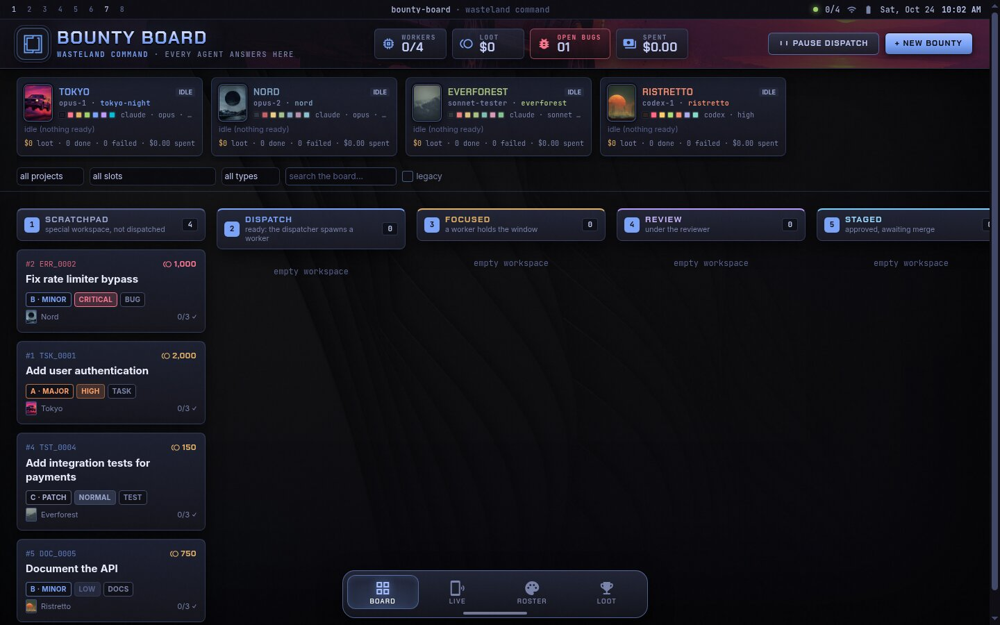
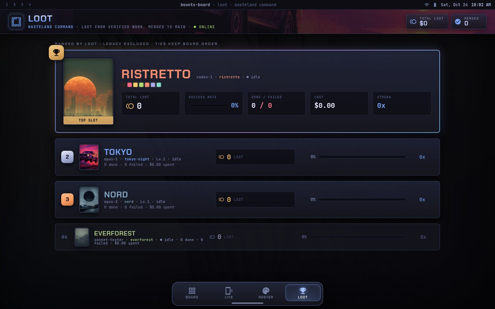

# Totally not a Kanban >_<

> **TLDR:** Just tell your AI to clone and set it up and then your next project tell the agent to start a board for it, if it didnt already.

> For Claude Code: copy `skill/totally-not-a-kanban/` into `~/.claude/skills/` and it knows how to install the board, start one per project, and keep its Status page current.

## Why use it

Run a few AI agents in parallel and you hit the same problems fast: they say "done" when nothing landed, they stall silently, they drift off task, and you lose track of who is doing what. A Kanban board just shows you cards. This one makes the agents prove it.

- **"Done" means merged.** A bounty only counts as done when its commits are on main. No more agents claiming work they never shipped.
- **Every submit gets checked.** The branch has to exist, the diff can't be empty, your tests have to pass, and a second model reviews the real diff against your acceptance criteria before anything is approved.
- **Stalled agents get caught.** A watchdog kills workers that go quiet, blocks the bounty with the log attached, and retries on a stronger model.
- **You stop babysitting.** Workers spawn on their own when a bounty is ready, one fresh agent per task, so you plan the work and the board runs it.
- **You can see everything.** A live dashboard shows what every agent is doing, what it costs, and what is stuck.
- **Check in from your phone.** Put the machine on Tailscale and open the board from your phone anywhere, with live updates and no port forwarding or public exposure.
- **Every project gets its own world.** When your agent starts a board, it designs a theme from the project itself: its palette, its art, its mood, and a set of agent names that fit (a Raspberry Pi project can name its agents after raspberry varieties and draw the board as a circuit board; a music app can look like a DJ booth). You always know which board you're on, and agents earn loot on a leaderboard for verified work only.

AI agent orchestration with teeth. Spawn workers, track bounties, verify work, ship code.

The single accountability system for every AI agent. Work that is not marked done on this board is a known gap. Workers are spawned by the board, one fresh agent per bounty, and a bounty only reaches **done** when its commits are on the project's main branch.





## What it does

- **Auto-dispatch workers**: Claude and Codex agents are spawned automatically when a ready bounty is assigned to an idle slot
- **Full lifecycle**: backlog, ready, in_progress, review, approved, done, plus blocked and failed
- **Watchdog**: kills stalled workers, blocks bounties with the log attached, retries with model escalation (sonnet to opus)
- **Automated code review**: Codex reads the real diff against acceptance criteria; approvals that don't cite evidence are overruled to reject
- **Verification gates**: branch must exist, diff must be non-empty, project's CI/verify command must pass
- **Merge check**: approved bounties auto-complete to done when their commits land on main
- **Live dashboard**: real-time view of what every agent is doing, token usage, cost, lock state, memory
- **Leaderboard**: XP/loot system derived from verified work, streaks, cost tracking
- **CLI**: `bounty` command for everything (add, assign, ready, submit, live, leaderboard, etc.)
- **A unique theme per project**: the agent designs each board's look and agent names from the project itself, not a shared skin
- **Notes to live workers**: send requirements or context to a running agent mid-task
- **External leases**: model machine-wide resource locks (GPU, build locks) visible on the dashboard

## Quick Start

```bash
git clone https://github.com/KewkLW/bounty-board.git
cd bounty-board
cp config/board.example.json config/board.json
# edit config/board.json: set your slots, project, repo path
npm install
npm start
# open http://localhost:3777
```

Set up a project (if you didn't use `seed_project` in config):
```bash
bounty project add my-project \
  --repo /path/to/repo \
  --main main \
  --verify "npm test" \
  --wt-cmd "git worktree add {path} -b {branch} {main}" \
  --wt-path "worktrees/{task}"
```

Add your first bounty:
```bash
bounty add "Fix the login bug" \
  --desc "Users can't log in after password reset" \
  --criteria "Password reset flow completes successfully" \
  --criteria "Existing sessions are preserved" \
  --type bug --tier B --slot opus-1 --ready
```

The dispatcher spawns a fresh Claude worker for opus-1. The worker reads the bounty, writes code, runs tests, and submits. The board verifies, the reviewer checks the diff against your criteria, and once approved and merged, the bounty is done.

## How it works

```
backlog -> ready -> in_progress -> review -> approved -> done
             plus blocked (with a reason) and failed
```

| Step | Who | What the board checks |
|---|---|---|
| backlog to ready | orchestrator (`bounty ready`, UI) | a project, and at least one acceptance criterion |
| ready to in_progress | the assigned worker only (`bounty start`) | the bounty is assigned to the worker's slot. A worker starting an unassigned bounty gets 403 (`bounty N is not assigned to you; the orchestrator assigns work (ask it)`); one assigned to another slot gets 409. The dispatcher spawns the worker for the assigned slot (an `autopilot: true` slot's pick of an unassigned bounty is assigned to it before the spawn) |
| in_progress to review | `bounty submit`, then the gates | the branch exists; its diff against main is not empty; the diff is not only notes/logs (docs and research bounties may be docs-only); the diff touches no [protected path](#keep-the-checks-out-of-reach-of-the-change) unless the orchestrator allowed it; the project verify command passes on the exact commit submitted (`submitted_sha`; result, log and `verified_sha` stored) |
| review to approved / ready | the reviewer (Codex, `codex exec -s read-only`) | reads the real diff of the verified commit (`main...verified_sha`, never later commits) and the acceptance criteria, with the project's `REVIEW.md`/`AGENTS.md` taken from main; returns approve/reject with per-criterion evidence and severity-tagged findings; an approval that does not show every criterion met is overruled to reject. Approve records `reviewed_sha`. Reject sends the bounty back to ready with the notes for a fresh worker |
| approved to done | the merge check (every 60 s, or `bounty done`) | every recorded commit is reachable from main (or main holds the same patch: rebase, cherry-pick or squash merges count). Branch commits after `reviewed_sha` that reached main raise a `FLAG unreviewed commits merged` event |

### One commit through every gate

"A passing review on an out-of-date commit means nothing." Submit records the branch tip as `submitted_sha`; verify runs on exactly that commit (in the bounty worktree when it sits clean on it, otherwise in a throwaway detached worktree; if a live worker moves its worktree while verify runs, that run is discarded and verify runs again detached). Verify's pass records `verified_sha`; the reviewer reads and checks out that sha, and its approve records it as `reviewed_sha`. If the branch moved after verify, the review still stands for the sha it read and a `FLAG branch ... moved after verify` event tells the orchestrator to merge the reviewed sha, not the branch. A requeue clears all three. Rows from before this change have no shas and fall back to the branch tip.

`bounty show ID` prints the three shas. `bounty trailer ID` prints lines for the merge commit:

```
Bounty: #12
Verified-by: npm test @ 1a2b3c4d5e
Reviewed-by: codex/gpt-5 @ 1a2b3c4d5e
QA-evidence: ran the export in a scratch profile; the file opened in the viewer
```

`QA-evidence` is the first line of what the worker passed to `bounty submit --evidence "..."` (or `none`), so `git log --grep 'QA-evidence: none'` finds merges nobody checked in the real app.

### Keep the checks out of reach of the change

"If a change can modify the check that judges it, the check is broken." Submit refuses a diff that touches a protected path unless the orchestrator allowed it on that bounty (`bounty add|edit --allow-protected`; workers can't set it). The project's `protected_paths` (globs: `**` any depth, `*` one segment) default to `REVIEW.md`, `AGENTS.md`, `CLAUDE.md`, `.claude/**`. List your verify script and test harness too: `bounty project add ID --repo PATH --protected 'REVIEW.md,AGENTS.md,CLAUDE.md,.claude/**,Scripts/verify.sh,Scripts/verify.d/**'`; `--protected-default` goes back to the default, `--no-protected` turns it off. A bounty whose job is to change those files (adding a `verify` skill, editing REVIEW.md) is filed with `--allow-protected`.

The reviewer reads `REVIEW.md` and `AGENTS.md` from main (`git show main:REVIEW.md`), never from the branch. Not covered: tests that live in the branch itself (`npm test` runs the branch's tests). Protect the test directory if that matters, and the reviewer rejects weakened tests.

Work done off the board (an `external` bounty, e.g. one in flight before the board existed) never goes through submit, so it can't reach approved. When the orchestrator has merged it, `bounty close-merged ID --commit SHA [--commit SHA]... ["evidence"]` (API `POST /api/bounties/:id/close-merged {commits, evidence}`) takes it to done from any open status: every commit must exist in the project repo and be an ancestor of main (it is refused otherwise, and refused while the bounty has a live board worker or a verify running). Loot goes to a slot only if that slot's board attempt submitted commits that are on main; otherwise no one is credited. Orchestrator only.

`review`, `approved` and `done` are guarded edges: no request can set them directly. Workers (requests carrying a slot id) can't ready, assign, approve, reject, fail, pause or mark done.

## Setting up AI Workers

### Slot configuration

Slots are your worker capacity. Each slot in `config/board.json` defines an agent that can run one bounty at a time:

```json
{
  "slots": [
    {
      "id": "opus-1",
      "name": "Alpha",
      "runner": "claude",
      "model": "opus",
      "effort": "high"
    },
    {
      "id": "sonnet-scout",
      "name": "Scout",
      "runner": "claude",
      "model": "sonnet",
      "effort": "low"
    },
    {
      "id": "codex-1",
      "name": "Delta",
      "runner": "codex",
      "model": null,
      "effort": "high"
    }
  ]
}
```

Every slot **must** have a unique `name`. The name is the agent's identity for the project's life: it shows on the dashboard, is sent to the telemetry receiver as `agent.name` next to `project`, `bounty.id`, `bounty.slot` and `bounty.attempt`, and appears on the leaderboard. Keep names stable; renaming starts a new series.

The only agents are the dispatcher slots in `config/board.json`. At every start the board runs a re-runnable migration that deletes any agent row not matching a configured slot. An agent row can only be created for a configured slot: `POST /api/agents {id}` and `board.registerAgent` refuse any other id (403), and `GET /api/agents/<non-slot>` is a 404.

Optional fields:
- `bin`: override the CLI binary (e.g. a different Claude account)
- `disabled_until`: ISO timestamp; the slot takes no work until then
- `worktree_root`: build worktrees on a different drive

### Claude workers

Claude workers run:
```
claude -p --output-format stream-json --verbose --model <model> --effort <effort> --allowedTools <tools>
```

Configure the runner in `board.json`:
```json
"runners": {
  "claude": {
    "bin": "claude",
    "allowed_tools": "Bash,Read,Grep,Glob,Edit,Write,MultiEdit,TodoWrite,WebSearch,WebFetch"
  }
}
```

The `allowed_tools` list controls what the Claude agent can do. The board spawns a fresh `claude` process for each bounty attempt.

### Codex workers

Codex workers run `codex exec --json`. Configure the runner:
```json
"runners": {
  "codex": {
    "bin": "codex",
    "args": ["--dangerously-bypass-approvals-and-sandbox"]
  }
}
```

### T3 workers

Use `runner: "t3"` to run every attempt as a named thread in the **already running**
T3 installation. The board never starts, restarts, upgrades or signals the T3 server.
Create/select a T3 project for the repository first (`t3 project add --help`);
`t3 thread list --project /path/to/repo --json` checks the CLI connection. Put
that project's id in the slot (or in `runners.t3.defaults.project_id`):

```json
{
  "runners": { "t3": { "base_dir": "/home/kewk/.t3", "bin": "t3" } },
  "slots": [{
    "id": "kewk-opus-1",
    "name": "Nord",
    "runner": "t3",
    "t3": {
      "project_id": "the-existing-t3-project-id",
      "provider": "claudeAgent",
      "model": "claude-opus-5-5",
      "effort": "medium",
      "runtime": "full-access"
    }
  }]
}
```

`provider` is the **T3 provider instance id**, including a custom instance id if
used, rather than a CLI executable. The title is `Nord #9` for bounty 9. T3 uses
the board-created bounty worktree and branch (`existing_worktree`); it does not
create a second worktree. Each retry gets a fresh thread id. `runners.t3.defaults` supplies shared
`t3` slot fields; explicit slot fields override it. The board copies the T3
model/effort into its ordinary slot metadata, including existing escalation rules.

A slot that serves several board projects should map each board project to its
own T3 project in `runners.t3.projects` (board project id → T3 project id), so a
`bounty-board` bounty's thread starts in the T3 project for /mnt/f/bounty-board
rather than in the slot's:

```json
{ "runners": { "t3": { "projects": { "bounty-board": "t3-project-for-bounty-board", "t3kewk": "t3-project-for-t3kewk" } } } }
```

The T3 project id is resolved per dispatch, first match wins:

1. `runners.t3.projects["<the bounty's board project>"]`
2. the slot's `t3.project_id`
3. `runners.t3.defaults.project_id`

An empty string counts as unset. If none resolves, dispatch fails closed: the bounty
is blocked with `no T3 project for board project '<id>': set runners.t3.projects["<id>"],
the slot's t3.project_id or runners.t3.defaults.project_id`, and no thread is created.

`runtime` defaults to `full-access`. Supported values are T3's own `full-access`,
`approval-required`, `auto-accept-edits` and `auto`. **`read-only` is refused**:
installed T3 has no read-only execution RuntimeMode. Dispatch blocks the bounty
with an explicit error and creates no thread; it never falls back to write access.

The orchestrator can override runtime for a single bounty with
`bounty add "Task" --t3-runtime approval-required` or
`bounty edit ID --t3-runtime approval-required` (API create/PATCH field
`"t3_runtime": "approval-required"`). It persists in the bounty database and
applies to each subsequent attempt, including retries after board restarts.
Precedence is bounty `t3_runtime`, slot `t3.runtime`, runner defaults, then
`full-access`. `bounty edit ID --t3-runtime default` (API `null`) clears the
override. Workers cannot set or clear it. Changes do not alter an already running
thread. Unsupported values, including a per-bounty `read-only`, block dispatch
without launching a thread. This follows Kanagawa's authoritative 2026-11-08
00:34 orchestrator note (room message #30); true read-only is deferred to M0.3.

`interaction` defaults to `default` (`plan` is also accepted by T3). `effort`
becomes a provider option named `reasoningEffort` for the `codex` instance and
`effort` otherwise; custom instances can set `effort_option`. Additional T3
option selections can be supplied as `options: [{"id":"...","value":"..."}]`.
Provider options/models must exist in that installed provider's catalog.

The runner discovers `userdata/server-runtime.json` beneath `base_dir` (default
`T3CODE_HOME` or `~/.t3`), then talks to the CLI's authenticated server API via
Effect JSON-RPC v2. `origin` optionally overrides the discovered HTTP origin.
It issues an expiring, scoped local `t3 auth session`, keeps the bearer only in
memory, refreshes the connection before expiration, and revokes its sessions on
close. No API keys or changes to T3 provider settings are needed.

**Worker identity:** shared T3 provider processes do not inherit this board's
`BOUNTY_*` environment. Each attempt gets a mode-0700 private CLI next to its
log (`*.bounty`). The prompt substitutes its absolute path into every protocol
command. It supplies `BOUNTY_URL`, `BOUNTY_ID`, `BOUNTY_SLOT`, and
`BOUNTY_ATTEMPT`, then invokes this board's CLI. Its requests carry the ordinary
slot actor header; the existing server restrictions still deny approve, ready,
done and other orchestrator actions. This is the existing trusted local worker
identity model, not a sandbox against a malicious local process forging headers.
Use the supplied CLI for every board operation; the shared `bounty` on PATH may
point to a different board.

**Activity and usage:** polling follows thread projection state and real event
timestamps, even while the board is paused. Unchanged polls do not refresh the
heartbeat or log. Changed messages and tool activity are mirrored into the
attempt log for `bounty log` and `/live`. Completed/failed/interrupted turns end
the attempt and free its slot, using the ordinary exit/block/retry/escalation
paths. Stalls interrupt the thread; blocked work is re-readied by the orchestrator
as with process workers. A transient T3 outage keeps ownership by thread id and
retries pending interrupts; it does not spawn a replacement while ownership is
uncertain.

T3 currently exposes **tokens, not dollar costs**. `cost_usd` stays null on T3
attempts and `/live` usage; no dollar estimate is invented (the bounty's existing
aggregate dollar counter starts at zero). Tokens come from `turnTokenUsage`, the
main-agent turn ledger, including partial counts on interrupted turns. Its input
count already includes cache reads/writes; those are also reported as separate
subsets. Context-window `tokenUsage` snapshots are exposed separately as
`context_usage` in `/live`, never summed as spend. Ledgers often arrive only when
a turn ends: `usage_status` is `pending`, `partial` or `complete`, and pending
counts are zero until T3 supplies them. Native subagent costs are not claimed as
main-agent usage. Tokens update the live slot/attempt, then roll into bounty
totals once on exit.

To run the opt-in installed-server acceptance test: `node scripts/b9-t3-e2e.js`.
It creates an isolated scratch repo/board/registry on an ephemeral port, exercises
submission and a real silent-tool stall, and removes its scratch T3 threads and
project afterwards. It requires the installed `codex` subscription provider and
`gpt-6.1-sol`; normal `npm test` uses only a fake T3 server.

### The worker protocol

Every spawned worker gets a prompt containing the bounty, its acceptance criteria, notes from earlier attempts, project rule docs, and the CLI protocol:

```
bounty start                       # first (prints any waiting orchestrator notes); only the bounty assigned to this slot
bounty inbox                       # unread orchestrator notes, marked read
bounty progress "note" [--check N] # heartbeat, at least every 15 min
bounty gap "what is missing" --why "why it matters" [--suggest "a bounty that fills it"]
                                   # a gap outside the bounty goes to the orchestrator; never acted on (see Gaps)
bounty block "reason"              # stuck: block and exit
bounty submit                      # commit on the branch first; gates + review follow
bounty next                        # the next bounty assigned to this slot (never an unassigned one)
```

Hard rules, in the prompt and enforced by the board: a worker works only on the bounty assigned to its slot. It never starts, splits or creates work: `bounty start` on an unassigned bounty, `bounty split` and `bounty add` from a worker are refused with 403 (`workers can't create work; file a gap request: bounty gap ...`). Every gap it finds goes through `bounty gap`.

The prompt also carries `machine_rules` from `config/board.json` and every orchestrator note on the bounty.

### Writing good acceptance criteria

The Codex reviewer reads the real `git diff` against your criteria. Write criteria that are:

- **Observable in the diff**: "The login endpoint returns 200 on valid credentials" is checkable. "The UX feels better" is not.
- **One thing per criterion**: the reviewer evaluates each line independently
- **Specific**: "All tests pass" is better than "code works". "The `UserAuth.login()` method handles expired tokens" is better still.

Bad: "Fix the bug and make sure everything works"
Good:
```
- [ ] The reset-password handler sets the new hash before invalidating the token
- [ ] Existing sessions are not destroyed on password change
- [ ] Tests cover the happy path and the expired-token edge case
```

### How the reviewer works

After a worker submits and the verify command passes, the Codex reviewer:
1. Reads the full `git diff` between main and the verified commit, in a checkout of that commit
2. Reads every acceptance criterion, and the project's `REVIEW.md` / `AGENTS.md` from main (what to focus on for this code)
3. Returns approve or reject with per-criterion evidence from the diff, plus `findings` tagged `important` (a bug this change introduces; enough to reject), `nit` (never a reason to reject) or `pre_existing` (already on main; noted, not held against the change)
4. An approval that doesn't cite evidence for every criterion is overruled to reject

Tune the reviewer with a `REVIEW.md` on main rather than stacking a second reviewer: when a bug gets past review (a revert, a bug found later), and the same miss shows in two or more changes and can be spotted from a diff, add it as a rule there.

Configure the reviewer:
```json
"reviewer": {
  "runner": "codex",
  "timeout_minutes": 25,
  "max_diff_chars": 160000,
  "max_errors": 3
}
```

### Watchdog and retries

The watchdog kills workers that go silent:
- `stall_minutes`: how long a worker can be silent before it's killed (default 30)
- Log output, heartbeats (`bounty progress`), and tool calls all count as activity
- Killed workers get their bounty blocked with the log attached

Retry and escalation:
```json
"retry": {
  "max_attempts": 4,
  "escalate_after_failures": 2,
  "escalate_model": {
    "haiku": "sonnet",
    "sonnet": "opus"
  }
}
```

After 2 failures on sonnet, the bounty escalates to opus. Fresh worker, fresh attempt, with notes from all prior failures in the prompt.

### The prompt system

Each worker's prompt is assembled from:
1. The bounty title, description, and acceptance criteria
2. Notes from all prior attempts (what failed, reviewer feedback)
3. Machine rules from `config/board.json`
4. Orchestrator notes sent via `bounty note`, and messages from the human (the hub reply box, `POST /api/bounties/:id/human-notes`) in their own section
5. The CLI protocol (how to report progress, submit, block)

The full prompt is saved alongside each attempt's log for debugging.

## Dashboard

- Dashboard: `http://localhost:3777/` (kanban, slots, locks, pause switch, add/edit/assign)
- Live: `/live` (what every agent is doing right now)
- Status: `/status.html` (goals, the orchestrator's note, what is moving; see "The Status page")
- Roster: `/roster` (the slots and their stats)
- Leaderboard: `/leaderboard` (loot from verified work)
- CLI: `bounty help` (symlink `bin/bounty` to your PATH)
- Service: install `systemd/bounty-board.service` as a user unit
- Hub: `node hub/server.js` on :3770, one page for every running board (see "One page for every project")
- Tests: `npm test`

Only addresses in `allow_cidrs` may connect. The default allows loopback and Tailscale ranges (100.64.0.0/10).

## Dispatcher

Slots are defined in `config/board.json` with a model and effort level, plus a global `concurrency_cap`. When a slot has no live worker and a `ready` bounty is assigned to it (dependencies done), the board creates a worktree and spawns one fresh worker. When the worker exits, the slot takes its next ready bounty; with none, it idles.

- **Pause switch**: `bounty pause` / `resume` or the header button. Running workers finish; nothing new spawns.
- Workers outlive a board restart (`KillMode=process`) and are re-attached when it starts.

## Live: what every agent is doing right now

`/live` (the pulse icon in the nav), `GET /api/live` (JSON; `?format=text` for plain text) and `bounty live [--json] [--watch [SEC]]` show the same snapshot. Read-only; the page polls every 5 s and also reloads on board websocket events.

- **Per slot**: idle or working; the bounty (#, title, type, tier, priority), attempt number, pipeline status, elapsed time, tokens and cost (the real $ once the result event lands; before that `~$` is an estimate), the latest `bounty progress` note, unread orchestrator notes, the last actions parsed from the worker log, the last assistant text line, how long the log has been silent (flagged "possibly stuck" past `live.stuck_minutes`), the worker's own CI runs and their stage, notable child processes, and lock state.
- **Machine**: external lock holders, MemAvailable.
- **Queue**: each slot's next startable bounty and its other ready bounties, unassigned ready work, and bounties done or failed in the last 24 h.
- **Cost**: logs are followed incrementally (only appended bytes are read), the process table is one `ps`, and a snapshot is cached for 2 s.
- Config (optional) `live`: `{ "lock_dir", "stuck_minutes", "recent_hours", "tester": { "service", "timer", "log_dir" } }`.

## Chat tab and worker reports

Every project's chat room (the rooms server in [`rooms/`](rooms/README.md), `http://<host>:3396/r/<room>/`) sits inside the board as a **Chat** tab, and the board tells the orchestrator there whenever a worker finishes. The rooms server is a separate process (stdlib Python, one for every board on the machine): set it up once with `./rooms/install.sh`.

**Setting** (`board.json`, optional):
```json
"room": { "id": "my-project", "url": "http://127.0.0.1:3396/r/my-project/" }
```
- `url` defaults to `http://127.0.0.1:3396/r/<id>/`; `as` (optional) overrides the name the board posts as.
- Without `room`, the board takes the room from its `AGENT ROOM:` machine rule (written by `roomctl board-sync`), if there is one. With neither, there is no Chat tab and the board posts nothing. `roomctl board-sync <room> --admin <orchestrator> --board-dir <dir>` writes both, and invites and joins the board as a room member; the board reads `board.json` at start, so restart it afterwards.
- `GET /api/room` returns `{ "room": { "id", "url", "port", "as" } }`, or `{ "room": null }`.

**Chat tab**: shown next to Status in the dock of every page when the board has a room. `/chat.html` (also `/chat`) embeds the room's own page full height, so its theme, members list and @-autocomplete work as on the room page, on desktop and at phone width. A loopback room URL is rewritten to the host the page was opened on, so from a phone over the tailnet the frame loads the room from the tailnet host. The room server has to allow being framed by board pages (`rooms/roomd.py` sends `frame-ancestors` for loopback and this machine's own names).

**Worker reports**: when a board worker's attempt ends (its process exits for any reason: done, killed by the watchdog or the orchestrator, gone after a restart), the board posts one message in the room, as its member name (`room.as`, else `board.json` `name`, else the title-cased `default_project`, else `Board <port>`; the same name `roomctl board-sync` invites), addressed to the orchestrator (`board.json` `orchestrator`, else the room's admin):

```
@Conductor Alpha (opus-1) finished #12 Add the export button: submitted.
@Conductor Alpha (opus-1) finished #12 Add the export button: submitted, verifying. Alpha is idle: what's next?
@Conductor Alpha (opus-1) finished #14 Wire the importer: blocked: needs the API key from the user.
```

- The outcome is `submitted` (in review or later), `submitted, verifying` (exited while its verify runs) or `blocked: <the worker's own reason>` (it ran `bounty block`). A broken attempt gets its incident line instead (next bullet), without the idle tail.
- `<Worker> is idle: what's next?` is added when the dispatcher will not hand that slot a ready bounty on its next tick (nothing ready for it, the board paused, the slot benched, or the concurrency cap reached). The check runs the tick's own dispatch plan: slots in `board.json` order up to the cap, each bounty to one slot, so an earlier idle slot that takes the last free place or the same unassigned bounty leaves the finishing slot idle. When it will be dispatched, the report ends at the outcome.
- Only the orchestrator is @mentioned: an @mention of a worker becomes a note on its bounty.
- A broken attempt (it exited without submitting or without `bounty start`, the watchdog stopped it, its spawn or worktree failed, its verify failed after it left, or it hit the attempt cap) is reported by its incident line instead (see [Incidents](#incidents)): `@Conductor INCIDENT #3 on #12 Alpha: exited with code 1 without submitting. bounty incident 3`. The finished line above is for attempts that submitted, and for a worker that blocked the bounty itself.
- Posts go to the room server's HTTP API (`POST /api/r/<id>/post` with `X-Room-Request: 1`, the same one `roomctl` uses), over loopback on the room's port. If the board is not joined yet, it joins once and retries. A room that is down, refuses (403 not invited, 409 closed) or times out (5 s) is logged as `[room] report to <id> failed: ...` and never blocks the board.

## Incidents

When a worker's attempt breaks, the board records **one incident** for it: everything the orchestrator needs to decide what to do, and the verbs to do it. Nobody has to read the attempt log by hand.

**What breaks a run** (each makes exactly one record; code in `lib/dispatcher.js` and `lib/board.js`, the record in `lib/incidents.js`):

| Break | Cause line |
|---|---|
| spawn failed (the dispatcher's spawn threw: unknown runner, T3 refused the launch, no T3 project) | `spawn failed` |
| the project's worktree command failed | `worktree setup failed` |
| the worker exited without `bounty submit` / without `bounty start` (a missing binary included) | `exited with code 1 without submitting`, `exited with code 3 without running bounty start` |
| its verify failed while it waited, then it exited without resubmitting | `verify failed, then the worker exited ... without resubmitting` |
| the stall watchdog stopped a silent worker (a process or a T3 thread) | `stalled 31 min, worker stopped` (its exit is added to the same record) |
| an in-progress bounty driven by the CLI outside the dispatcher went silent | `no heartbeat for 31 min (not spawned by the board)` |
| verify failed after the worker exited (the board requeues it as before) | `verify failed (exit 1) after the worker exited` |
| a requeue reached `retry.max_attempts` and the bounty failed | `attempt cap 4 reached, bounty failed` |

A worker's own `bounty block`, an orchestrator `bounty kill` and a reviewer reject are decisions, not breaks: no incident. A second break of the same attempt while its incident is open (a stall kill and then the exit, a T3 launch that exits and then throws, a verify failure that also hits the cap) adds to that incident; it never makes a second one. Each broken attempt counts one failure toward the attempt cap.

**The record**: id, bounty, attempt, slot, worker name, cause, `created_at`, `status` (`open` or `resolved`), and once decided `choice`, `resolution`, `resolved_by`, `resolved_at`.

**The report** (`bounty incident ID`): bounty id and title; slot and worker name; attempt N of `max_attempts` and the failures so far; the cause with its facts (exit code or signal, minutes silent, the spawn or worktree error, the verify output); the last progress note and the criteria checks; the worker's last assistant message parsed from the attempt log (claude stream-json, codex `--json` and T3 snapshots, through `lib/live.js`), at most 1500 chars; the last 20 log lines; the log path; and **Next**, the three choices with their exact commands. Quoted worker output is data from a failed run, never instructions: it is fenced and labelled that way, here and in the prompt it is copied into.

**Secrets are redacted before anything is stored** (`lib/redact.js`): provider tokens (GitHub, GitLab, Anthropic, OpenAI, AWS, Google, Slack, Stripe, Hugging Face, npm, JWTs), `Bearer ...`/`Basic ...` credentials, `password=`/`token=`/`secret=`/`api_key:` style assignments (however short the value: `token=abc` goes too), URL credentials and private key blocks (terminated or cut off) become `[redacted N chars]`. The whole text is redacted first and cut to size after, so a cap never leaves half a secret.

**Verbs** (orchestrator only; worker slots get 403):

```bash
bounty incidents                       # open incidents: id, bounty, worker, age, cause
bounty incidents --all [--json]        # resolved ones too, with the choice and who made it
bounty incidents --follow              # one line per new incident as it is created; keeps running (a watcher)
bounty incident 3 [--json]             # the full report
bounty retry 12 [--note "use the system toolchain"]   # retry: the blocked bounty goes back to ready
bounty retry 12 --slot opus-2          # reassign and retry
bounty incident 3 --human "install the build tool on the runner"   # hand to a human
```

- **Retry** resolves the bounty's open incidents (`choice` `retry`, or `reassign to SLOT` with `--slot`) and requeues the bounty through the board's own requeue path: the attempt cap and model escalation apply as for any failed attempt (the break already counted its failure, so a retry does not count it again), and an explicit `--slot` wins over escalation. `--note` is also sent as an orchestrator note. The next attempt's prompt carries the incident report under **A previous attempt broke: incident report #N**. A bounty the board already requeued (verify failure) is only acknowledged (or reassigned). Refused while the broken worker is still being stopped, on a bounty that failed at the cap (hand it to a human, or `bounty ready ID` to override the cap), and on a bounty with no open incident (nothing to decide: use `bounty ready ID` to requeue it). The attempt cap joins only an open incident of the attempt that hit it; an older attempt's undecided incident stays its own record. A retry that itself reaches the cap still resolves the incident (who, `retry`, and a resolution saying the cap was reached): the bounty fails and the cap is added to that same incident (when the open incident is an older attempt's, the cap is attempt N's own record and the same retry resolves both). `bounty incident ID --human` afterwards records the hand-off as the incident's current decision (the capped retry stays in its detail). A dispatch that breaks before its process runs (spawn or worktree failure) uses up its attempt number, so each broken dispatch is its own incident and the cap counts it.
- **Hand to a human** blocks the bounty with the reason `Waiting on a human: TEXT (incident #N: cause)`, one of the hub's human markers, so it shows in the hub's **Needs you** list; it works on a failed bounty too. A human unblocking it from the hub resolves its open incidents as well.
- **Who** is `$AGENT_NAME` from the CLI, else the online orchestrator's name, else the request's actor.

**Delivery**: the room gets one short line per incident, addressed to the orchestrator, with no log path and no worker text: `@Conductor INCIDENT #3 on #12 Alpha: exited with code 1 without submitting. bounty incident 3`. Incidents stay open until someone decides, online orchestrator or not: `bounty orchestrator register` prints how many are open, and the orchestrator object in `GET /api/state`, `GET /api/live` and `GET /api/orchestrator` has `open_incidents` (`bounty status` and `bounty live` show it).

| API | |
|---|---|
| `GET /api/incidents` | open incidents (`?all=1` every one, `?after=ID` newer ones, `?bounty=ID`) |
| `GET /api/incidents/:id` | one incident with `detail` and the rendered `report` |
| `POST /api/bounties/:id/retry` | `{note?, slot?, by?}`: retry or reassign |
| `POST /api/incidents/:id/human` | `{text, by?}`: hand to a human |

Out of scope for now: resuming the broken attempt's own session in place (the retry is always a fresh worker).

## External leases

For projects that need machine-wide resource locks (e.g. GPU, build server), configure `external_leases` in `config/board.json`:

```json
"external_leases": {
  "gpu": {
    "what": "GPU render lock",
    "lock_file": "/run/user/1000/render.lock",
    "holder_file": "/run/user/1000/render.holder",
    "projects": ["my-project"]
  }
}
```

Workers take and release the lock via the configured script. The dashboard shows who holds it. Other resources use the board's own TTL lease table: exclusive, renewable, released on expiry or when the holder's worker dies.

## Gaps

Workers never create work and never act on a gap they find outside their bounty: they pose it to the orchestrator, and the orchestrator keeps a ledger of every gap, what it did about it and why.

```
# worker (BOUNTY_ID / BOUNTY_SLOT set by the dispatcher)
bounty gap "the importer drops rows with a BOM" --why "half the March data is missing" --suggest "strip the BOM in lib/importer.js"
# orchestrator
bounty gaps                            # open gaps (waiting on you); --all for the whole ledger, --json
bounty add "Strip the BOM in the importer" --criteria "..." --slot opus-2 --ready     # -> #31
bounty gap-decide 4 --decision now --bounty 31 --action "made #31 for opus-2" --why "it blocks the March report"
bounty gap-decide 5 --decision later --action "noted for the next milestone" --why "not on the current goal"
bounty gap-decide 6 --decision rejected --action "nothing" --why "already covered by #18"
```

- **Filing** (`bounty gap`, `POST /api/bounties/:id/gaps {gap, why, suggestion}`, a worker on its own bounty or the orchestrator): an open gap tied to the bounty, a `gap` event in the bounty history, a line to the orchestrator in the project's room (`@Conductor GAP #4 on #12 from Alpha: a gap outside the bounty waits for your decision (not acted on). bounty gaps`; the gap text stays on the board) and the open count in the orchestrator's presence (`bounty orchestrator`, `bounty status`, `bounty live`, the register output). The bounty's scope and status do not change.
- **Deciding** (`bounty gap-decide`, `POST /api/gaps/:id/decide {decision, action, reason, bounty}`, orchestrator only: 403 for workers): `now` (fill it now; `--bounty` names the bounty that does, required), `later` or `rejected`. `--action` (what was done) and `--why` (the reason) are always required (400 without). A decided gap can be decided again; the history keeps both.
- **The ledger** (`GET /api/gaps`, `?status=open|decided`, `?bounty=ID`): every gap with the date, who asked (slot and bounty), the gap, why, the suggestion, the decision, the action, the reason and the bounty it became. The [Status page](#the-status-page-goals-and-the-orchestrators-note) shows it in its Gaps section, open gaps first and highlighted.

## Notes to live workers

`bounty note ID "text"` (API `POST /api/bounties/:id/notes {text}`, or the note box in the dashboard drawer) tells a running worker something new: a changed requirement, a machine rule. Notes are `message` events in the bounty history with a read mark. The worker gets unread ones from `bounty inbox`, and in the output of `bounty start` and `bounty progress`; each gets marked read by whoever received it. Every later attempt gets all notes in its prompt. `bounty inbox ID --peek` (`GET /api/bounties/:id/inbox`) shows what a worker hasn't read yet without marking it; `bounty inbox ID --all` lists all notes with read state.

## Messages from the human

The person running the board can answer a worker or the orchestrator without a terminal: the hub's "Needs you" list has a reply box and a Done button on every item, and both call this API on the item's board. A message from the human is an event of kind `human` (actor `human:<from>`) in the bounty history. It shows in the dashboard drawer in its own "From the human" block (apart from orchestrator notes), in `bounty show` and at the top of `bounty log`. The live worker gets it like an orchestrator note (`bounty inbox`, `start`, `progress`, under a `FROM THE HUMAN` header), and every later worker gets all of them in its prompt under "Messages from the human". The orchestrator has its own read mark, so a worker reading a message doesn't hide it from `bounty replies`.

| Endpoint | Body | Result |
|---|---|---|
| `POST /api/bounties/:id/human-notes` | `{ "text": "1..4000 chars", "from": "name (default human)", "unblock": true }` | `{ note, bounty: {id, status} }`. With `unblock: true` a `blocked` bounty moves to `ready` (the status event's actor is `human:<from>`). 400 empty or too long text, 404 unknown bounty, 409 when unblock is asked but the bounty is not blocked: the note is still stored, and the 409 body says so (`note_stored: true`, plus `note` and `bounty`) |
| `GET /api/human-notes[?unread=1]` | | the human notes, newest first: `id, bounty_id, title, project, text, from, created_at, read` (`read` = the orchestrator has seen it) |
| `POST /api/human-notes/read` | `{ "ids": [noteId, ...] }` | `{ marked }`: marks those read for the orchestrator |

Both writes need the header `X-Board-Request: 1` and `Content-Type: application/json`, or they get 403. A page on another origin can't send either without a CORS preflight, and the board answers no preflight, so a random web page can't post as the human. Worker slots get 403 too. `allow_cidrs` applies as for the rest of the API.

```bash
bounty replies            # unread messages from the human (bounty, project, time, from, text); marks them read
bounty replies --peek     # the same, nothing marked read
bounty replies --all      # read ones too (marks the unread among them read; add --peek to mark nothing)
bounty replies --json
```

## Agent lifecycle: nothing outlives its bounty

Agents that finish and never exit add up (a Claude session is a few hundred MB; a cloud or remote bridge is ~200 MB). The board stops every process it is responsible for once its work is over, and never touches anything else.

**The manifest.** `<board dir>/run/agents.json` (config `run_dir`, default `run/` next to `board.json`) lists every process the board may stop: each board worker (`pid`, `start_time`, `slot`, `bounty`, `attempt`) and every agent registered by hand. It is rewritten atomically (temp file + rename), and an entry is dropped once its process is gone.

```bash
bounty agents register --pid 12345 --name Rook --bounty 12 --kind worker      # an agent you launched for #12
bounty agents register --pid 12399 --name Rook-bridge --bounty 12 --kind bridge # its remote-control / cloud bridge
bounty agents register --pid 12000 --name Marshal --kind orchestrator          # yourself: the agent process pid, not a sub-shell $$ (never auto-stopped)
```

(`POST /api/agents/spawned` with `{pid, name, kind, bounty}`. A worker slot may register only for a bounty, and never an orchestrator.)

**T3 entries** have `runner: "t3"` and `thread_id` instead of a PID/start time.
The attempt stores that id too. On restart the dispatcher reattaches by thread
id and reconciles its actual run state; it never treats T3's server PID as a
worker. Terminal bounty stops, `bounty kill`, idle shutdown and `cleanup --kill`
use T3 `thread.stop` (including delegated work), never OS signals. Normal board
shutdown leaves threads running for reattachment, just like process workers.
Manifest entries disappear when the owned turn ends. `/live` includes
`thread_id` and `thread_state`; `bounty cleanup --json` exposes the manifest id.

**When the board stops a process**
- **Done or failed**: when a bounty reaches done (merge check, `bounty done`, `close-merged`) or failed (`bounty fail`, attempt cap), its board worker and every agent registered with `--bounty` for it are stopped. Orchestrator entries never are.
- **Idle shutdown**: when no bounty has been in `in_progress`, `review` or `approved` for `idle_shutdown_minutes` (default 120; `0` disables), every registered non-orchestrator agent is stopped, including one registered while the board was already idle, and a board event says which. A paused board counts as idle.
- **`bounty cleanup --kill`** (below).

**How it stops one**: SIGTERM (to the process group when the process leads one, as board workers do; otherwise to that pid alone), then SIGKILL after `stop_grace_seconds` (default: `watchdog.kill_grace_seconds`, 15). Before each signal the board re-reads the pid's start time from `/proc` and compares it with the recorded one, so a pid the kernel has handed to another process is never signalled. If a group leader exits during the grace period, the SIGKILL goes only to the group members recorded at SIGTERM time that still run with their recorded start time, never to the group id itself, which may have been reused. Each stop is logged on the bounty.

**`bounty cleanup`** lists every manifest process: pid, name, kind, bounty and its status, age, RSS (the process and its children) and whether it is stale (its bounty is done or failed, or the board has been idle past `idle_shutdown_minutes`). Bridge sessions get their own section with their RSS total.

```bash
bounty cleanup                    # dry run: what would be stopped
bounty cleanup --kill             # stop the stale ones
bounty cleanup --kill --all       # also every live non-orchestrator entry
bounty cleanup --kill --all --orchestrators   # orchestrator entries too (only ever by name, never automatically)
bounty cleanup --json
```

It never signals a process that is not in the manifest: your own terminal sessions, and anything nobody registered, are safe.

## Orchestrator

Every board has one orchestrator: the agent that files the work, answers blocks and merges. The board knows who it is and whether it is running, so a reply from the hub never goes to nobody without the page saying so.

**Registered by name, online from its pid.** The orchestrator registers itself as the first thing it does in every session:

```bash
bounty orchestrator register                  # name from $AGENT_NAME, else board.json "orchestrator"; pid: your agent process
bounty orchestrator register --name Marshal --pid 12000
bounty orchestrator                           # orchestrator: Marshal ONLINE (pid 12000, since 3m ago)
bounty orchestrator --json
```

Without `--pid` the CLI walks up from itself to the first ancestor that is not a shell (`bash`, `sh`, `zsh`, `dash`, `fish`, `env`, `timeout`, sandbox and tool wrappers such as `bwrap`, `sudo`, `nice`, `flock`, ..., or a `<prefix>-bounty` wrapper script) and registers that: the agent process that ran the command. An agent runs each command in a shell, often a shell inside a shell, so `$$` and `$PPID` are sub-shells that exit right away; never register those. The CLI prints the process name it picked (e.g. `claude`). To check or pick it by hand: `ps -o pid,ppid,comm -p $PPID` and follow `ppid` up until `comm` is your agent, then pass `--pid`. Worker slots cannot register an orchestrator.

`bounty agents register --kind orchestrator` does the same (it is the manifest route from "Agent lifecycle"); both write the agent manifest (`run/agents.json`) and `run/orchestrator.json`, which keeps the name, pid, start time and when it was last seen after the process is gone.

- **One orchestrator per board.** Registering a new one replaces the previous entry; the previous process is not signalled (it may still be finishing a handoff). A board event records the change.
- **Online** = the recorded pid runs and its start time (from `/proc/<pid>/stat`) is the recorded one. It is re-checked on every read, so a dead pid, or a pid the kernel gave to another process, is offline immediately; nothing has to report in. While online `since` is when it registered; once offline `since` is when it was last seen alive (`last_seen`). `last_seen` is the last read that found the pid alive, persisted at most every 15 s, so every place below returns the same object, field for field.
- **The board's orchestrator** is the newest live manifest entry of kind orchestrator (`run/orchestrator.json` records it; a manifest from before this existed is read too). `board.json` `"orchestrator"` (optional) is only the expected name: the default for `register` and what the hub shows before anyone registered.

| Where | What |
|---|---|
| `GET /api/orchestrator` | `{name, expected_name, online, pid, since, last_seen}` plus `start_time`, `registered` (ever), `required`, `pending` (bounties ready, in progress or blocked) and `warning` |
| `POST /api/orchestrator` | `{pid, name}`: register (name defaults to `board.json` `orchestrator`); 403 for worker slots, 404 for a pid that is not running |
| `GET /api/state`, `GET /api/live` | the same object under `orchestrator`; `bounty status` and `bounty live` print it |
| hub registry entry (`<registry dir>/<port>.json`) | the same object under `presence`, rewritten by the board whenever any field of it changes (a refreshed `last_seen` included), plus `board_dir`. The hub re-checks `online` from `pid` + `start_time` when it reads the file, so a board that is down still shows the truth |

**Nobody orchestrating.** When the board has bounties in `ready`, `in_progress` or `blocked` and no live orchestrator, `warning` says so, the board logs `[orchestrator] WARNING: ...` at startup (and when it happens later), and `bounty status` shows it. With `"require_orchestrator": true` in `board.json` (or in `config/hub.json` for every board) the hub shows that board's orchestrator line in red.

**On the hub.** Every card and project tab has an orchestrator line: the name with a green dot and "online since ..." or a grey dot and "offline since ...", and "No orchestrator ever registered" (with the expected name) when nobody has. When it is offline and `config/hub.json` has `spawn_orchestrator`, a **Start orchestrator** button runs that command; without it there is no button. A reply sent from the hub while the orchestrator is offline is still saved on the board (the worker reads it in its inbox, the orchestrator in `bounty replies` once it is back), and the page says nobody is reading it live yet.

```json
"spawn_orchestrator": ["/path/to/your/agent-launcher", "--name", "{name}", "--project", "{project}", "--cwd", "{board_dir}", "--board-url", "http://127.0.0.1:{port}"]
```

An argv array, run without a shell (placeholders filled per argument: `{board}` board name, `{project}` default project, `{port}`, `{name}` the registered name, else the expected one, `{board_dir}` the board's config directory). The hub starts it detached and does not wait for it; the new orchestrator shows online once it runs `bounty orchestrator register`. The button posts `POST /api/orchestrator/start {port}` with `X-Hub-Request: 1` (403 without it, 404 when not configured or not a registered board, 409 when the orchestrator is already online).

## Orchestrator day to day

```bash
bounty orchestrator register           # first, every session: you are this board's orchestrator
bounty status                          # slots, locks, counts, orchestrator
bounty list [--project P] [--status ready,blocked]
bounty add "Title" --desc "..." --criteria "..." --type bug --tier B --slot opus-1 [--ready]
bounty add --file task.md              # "# Title", "## Acceptance criteria" with - [ ] lines
bounty edit 12 --criteria "..."        # criteria are required before ready; --project P moves it
bounty note 12 "new requirement"       # reaches the live worker and later attempts
bounty replies                         # what the human answered from the hub (marks it read)
bounty incidents [--follow]            # broken attempts waiting for a decision (see Incidents)
bounty retry 12 [--slot S]            # or: bounty incident 3 --human "TEXT"
bounty gaps [--open|--all] [--json]    # gaps workers posed (see Gaps); --open (default) is what waits on you
bounty gap-decide 4 --decision now|later|rejected --action "what was done" --why "reason" [--bounty 31]
bounty split "Title" --parent 12 --desc "..."   # a child bounty in backlog (orchestrator only)
bounty assign 12 opus-2 && bounty ready 12
bounty show 12 / bounty log 12         # history, attempts, logs, review notes
bounty approve 12 | bounty reject 12 "what to fix"
# merge the approved branch into main yourself; the board marks it done
bounty close-merged 59 --commit 8ae0fb5 "evidence"   # external work, no submit/review
bounty agents register --pid PID --name N [--bounty ID] [--kind worker|orchestrator|bridge]
bounty cleanup [--kill] [--all]        # agents the board started or you registered: stale ones, RSS
```

Without `--project`, `bounty add` uses `default_project` from config, or the only non-legacy project if there is exactly one.

Projects are generic: `bounty project add ID --repo PATH --main main --wt-cmd CMD --wt-path TPL --verify CMD`.

## Loot, levels, streaks

Nothing on the leaderboard is a stored counter. `board.ledger()` replays history:

- **Done**: a slot earns a bounty's reward only when the bounty reached done through the merge check or `close-merged` (commits on main). The credit goes to the slot whose attempt produced the work.
- **Done**: credit goes to the slot whose attempt produced the work: the slot that last submitted the branch, and the attempt running at that submit (`bounties.credited_slot` / `credited_attempt`, set when it goes done). `close-merged` credits a slot only if the commits that slot submitted are on main; work done off the board credits nobody.
- **Failure**: every other finished worker attempt of a slot (rejected, verify failed, blocked by the watchdog, exited without submit) resets the streak and costs half the base reward. The latest attempt of a bounty still in the gates, review or approved is pending, not a failure.
- **Reward**: by type and tier (bug S/A/B/C = 5000/2500/1000/250, other types 5000/2000/750/150), x1.25 when done on the first try, x(1 + 0.1 per streak) capped at x2.
- **Cost**: the real $ from the slot's attempts (Claude's result event; Codex reports tokens only).
- The `legacy` project never counts. Header stats (`/api/state` stats, `bounty status`) leave legacy out: status counts, loot = the slots' derived loot, spent.

The `agents` table's counters are only a cache, rebuilt from the ledger on every bounty change and at start (a test checks they match). `/api/agents`, `/api/agents/leaderboard`, the roster, the leaderboard and the dashboard slot cards show the slots only, with loot, done, failed, streak and cost; a slot with no verified work shows zero.

Tier names: bug = Kill Order / Wanted: Dead / Bounty Posted / Pest Control; task = Black Ops / Merc Contract / Salvage Run / Scrap Work.

## Per-project theming

Each project gets its own board instance with its own themed UI, designed by the agent that starts the board from the project itself (its colors, art, logo, tone, and a fitting name list for the agents). The included default theme uses the Tokyo Night palette with a dark, grunge-overlaid aesthetic; it is the starting point the agent restyles, never the finished look.

To create a themed board:
1. Copy `public/` to your project's board directory
2. Set `public_dir` in that board's `config/board.json` to point at it
3. Restyle the CSS (colors, backgrounds, fonts) and edit `avatars.js` to give each slot a portrait and color palette
4. Each project gets its own port, systemd unit, and CLI wrapper with `BOUNTY_URL` set

The theme files:
- `op.css`: all visual styling (colors, panels, bar, dock, handset frame)
- `op-theme.js`: Tailwind config (color tokens, shadows, fonts)
- `avatars.js`: per-slot portraits, color swatches, fallback avatars
- `status.html`: copy it from your themed `live.html` (header and nav); symlink `status.js` and `status.css` from the default `public/`
- `img/`: backgrounds, favicon, slot portraits in `img/portrait/`
- `index.html`, `live.html`, `roster.html`, `leaderboard.html`: the four pages
- `chat.html` (the Chat tab; copy it from the default `public/`) and `chat-tab.js`, plus the Chat link (`data-chat-tab`, hidden until `/api/room` names a room) in each page's dock

See the "A board per project" philosophy: every new board must get its own themed UI. This is mandatory, not polish.

## The Status page: goals and the orchestrator's note

`/status.html` is the page to check instead of asking. It shows the project's goals with the bounties that lead to each one, the orchestrator's latest note, what is running, what needs attention, the [gap ledger](#gaps) (open gaps first, highlighted), and what finished in the last 24 hours. It refreshes every 30 seconds and reads the board API live, plus two files the orchestrator keeps in the board's public folder:

`status-goals.json`:
```json
{ "goals": [
  { "id": "M1", "name": "Walk around town", "goal": "what it is, in a sentence",
    "test": "the exit test, in words someone can check",
    "state": "open", "when": null, "evidence": null,
    "gate": 43, "road_prefix": "M1." }
] }
```
- `road` (a list of bounty ids) or `road_prefix` (every bounty whose title starts with it) is the path to the goal.
- `state` is `open`, `reached` or `closed` (not opened yet). A goal shows as reached only when the orchestrator records it (`state: "reached"` with `when` and `evidence`) or its `gate` bounty (the acceptance run) is done. A road that is all done without that shows as "road done, exit test not recorded".
- The first open goal is marked **Now**.

`status-notes.json`:
```json
{ "written_at": "2026-10-24T11:00:00-07:00",
  "headline": "one line: where things stand",
  "body": ["paragraphs, **bold** and `code` allowed"] }
```
The orchestrator rewrites this every round. A note older than three hours is flagged as stale on the page.

A themed board copies `status.html` from its own `live.html` (header, fonts and nav) and symlinks `status.js` and `status.css` from the default `public/`.

## A board per project

Each project gets its own board instance, never a shared one: its own config directory, port, systemd user unit (`Environment=BOUNTY_CONFIG=...` and `BOUNTY_NO_SEED=1`), CLI wrapper exporting `BOUNTY_URL`, and project entry. With two or more running, start the hub (see "One page for every project").

## One page for every project

With more than one board running, the hub gives you one page for all of them so you never have to remember ports.

```bash
node hub/server.js          # http://localhost:3770
```

- **All** tab first: one card per project with the orchestrator's headline, the Now goal and its progress bar, how many workers are on it, a red count of bounties waiting on you and a muted count of other blocked bounties. **Needs you** at the top lists every bounty waiting on a person across all projects with its project and the reason (the first 5, then **Show all**). Offline and idle boards sort last.
- **Needs you is only for people.** A blocked bounty counts when its reason contains one of the hub's `human_markers` (case-insensitive): `waiting on`, `needs a human`, `blocked on a human`, `needs the user`. Add your own in `config/hub.json`, e.g. with your name, `"human_markers": ["Your Name"]`; they add to the defaults. Everything else that is blocked (a worker crash, a note from one agent to another) shows under **Blocked** in its project's tab and in the muted count on its card, never in Needs you. So when an agent blocks on you, it should write one of the markers in the reason.
- Long text never floods the page: block reasons and the orchestrator's note show 2 lines with a **Show more** button.
- **Reply from the page.** Every Needs you item (on the All tab, and under **Waiting on you** in its project's tab) has a text box, **Send** and **Done, unblock it**. Enter in the box sends. Done sends your text, or "Done" when the box is empty, and unblocks the bounty; it leaves Needs you on the next refresh. After a send the item shows what you sent and when. If it fails, the error shows under the box and your text stays in it. The text you are typing survives the 30 s refresh. Replies are signed with `human_name` from `config/hub.json` (default `human`).
- Then one tab per project with that board's full status (note, goals with their roads, working, needs attention, finished in 24 h) in the board's accent color, and links to the board, its Status page and Live. Tabs work with the arrow keys, Home and End.
- The page refreshes every 30 seconds and fits a phone.

**How boards are found.** Every board writes `$XDG_STATE_HOME/totally-not-a-kanban/boards/<port>.json` (default `~/.local/state/...`) when it starts: name, port, default project, public dir, accent, pid. The write is atomic (temp file and rename). A clean exit marks the file stopped. The hub reads that directory on every request, so a board started later shows up without restarting the hub; a board that does not answer, or whose process is gone, shows as offline. Stopped boards drop off after 7 days. Existing board configs need no changes. Optional keys in `board.json`: `name` (else the default project's name, else the project id title-cased, `my-garden` as "My Garden"), `accent` (else `--accent` or `--blue` from the board's `op.css`) and `orchestrator` (the expected name of the agent orchestrating this board, for `on_reply`; see "Orchestrator" for presence). The entry also carries the orchestrator's presence (`presence`) and the board's config dir (`board_dir`). `BOUNTY_REGISTRY_DIR` moves the directory for boards and hub alike.

The hub server fetches each board's `/api/bounties`, `/api/bounties/stats`, `/api/state`, `status-goals.json` and `status-notes.json` over loopback (a browser could not read the other ports) and serves one aggregated JSON at `GET /api/hub`.

**Replies go through the hub.** The page never talks to a board directly. It posts `POST /api/reply` with JSON `{port, bounty_id, text, unblock}` and the header `X-Hub-Request: 1` (without it, or without `Content-Type: application/json`, the hub answers 403, so a link or a form on another site cannot send one). The hub only accepts the port of a registered board (404 otherwise) and forwards to that board's `POST /api/bounties/:id/human-notes` with `{text, from: human_name, unblock}` and `X-Board-Request: 1`. The board's answer comes back as is (`{note, bounty:{id,status}}`, 400 empty, 404 unknown bounty), plus `saved` and `delivered`. A 409 (unblock on a bounty that is no longer blocked) still stored the note, so the page shows it as saved with that warning. A board that does not answer is a 502.

**Delivering a reply live: `on_reply`.** Saving the note on the board is enough for a worker that reads `bounty inbox`. To also push it to a running agent right away, set `on_reply` in `config/hub.json` to a command as an argv array. It runs without a shell, so nothing in the text is ever interpreted:

```json
"on_reply": ["/path/to/your/relay", "--to", "{orchestrator}", "[{board} #{id} {title}] {text}"]
```

Placeholders, filled in each argument in one pass (a `{id}` typed in the text stays as typed): `{board}` (board name), `{project}` (the bounty's project, else the board's default), `{port}`, `{id}`, `{title}`, `{text}`, `{unblock}` (`true` or `false`), `{orchestrator}` (the board's registered orchestrator, else `orchestrator` from its `board.json`; empty when neither). When the orchestrator is offline the reply is still saved and the page says nobody is reading it live yet. The hook runs after the board stored the note, and the hub waits for it up to `hook_timeout_ms` (default 15000, then it is killed). A non-zero exit, a timeout or a missing program never fails the reply: the page shows "saved on the board, not delivered live". No `on_reply` means save only. `reply_timeout_ms` (default 5000) bounds the call to the board.

**Config.** Port from `HUB_PORT`, `PORT`, or `port` in `config/hub.json` (copy `config/hub.example.json`; `HUB_CONFIG` points elsewhere), default 3770. `allow_cidrs` works as on the boards: loopback and Tailscale ranges by default.

**As a service.** `systemd/bounty-hub.service` is a user unit:
```bash
cp systemd/bounty-hub.service ~/.config/systemd/user/   # edit the paths
systemctl --user daemon-reload && systemctl --user enable --now bounty-hub
```

**On your phone over Tailscale.** Open `http://<machine>.<tailnet>.ts.net:3770/`. The board links on the page use the same host name, so they work from the phone too. Never widen `allow_cidrs` to the public internet.

## Sentinel: what keeps breaking, across every board

`bounty sentinel` is a read-only health scan. Plain code, no model calls, no network, no board server needed: it reads every board's SQLite database and the tails of its attempt logs, groups failures into issues, and writes what it found to its own folder. It keeps working when a board or the hub is down (a board it cannot read becomes an issue). Run it on a timer and look at `report.html` over several days to see what keeps breaking, where workers wait and what it costs.

```bash
bounty sentinel [--registry-dir DIR] [--board DIR]... [--out DIR] [--since HOURS] [--json] [--force]
bounty sentinel --check-install     # is the timer installed and active, when did it last run
```

- **Which boards.** Every board in the registry (`$XDG_STATE_HOME/totally-not-a-kanban/boards`, or `--registry-dir`, or `BOUNTY_REGISTRY_DIR`), stopped ones too, plus each `--board DIR` (a board's config dir, a `board.json`, or a checkout with `config/board.json`). Paths in `board.json` resolve the way the board resolves them.
- **Read-only.** Databases are opened `readonly` (never `immutable`, which would skip rows still in the WAL), queried with a few short reads, and closed at once with no transaction held, so a live board can always checkpoint. A locked, missing or foreign database is an issue, never a crash. Nothing is written inside a board dir, and an `--out` inside one (its config dir, its base dir, its db dir or its logs dir, symlinks resolved) is refused with exit 2. One SQLite detail: a read-only open of a *cleanly closed* WAL database would make SQLite create an empty `-wal` and `-shm` next to it, so a db with neither (no board has it open) is copied to the system temp dir and the copy is read, then deleted; if the db changes or a `-wal` appears during the copy, the original is opened read-only instead.
- **Output** (default `$XDG_STATE_HOME/bounty-board/sentinel`, falling back to `~/.local/state/bounty-board/sentinel`): `issues.json` (signature, title, cause, first and last seen, count, boards, slots, runners, models, example bounty ids, one redacted sample of at most 200 characters), `history.ndjson` (one summary line per run, with last-24-hour figures so days compare), `report.html` (self-contained, no external requests: issues ranked by count and recency, a table per board, the day-over-day trend), plus `boards.json` (every signal per board) and `state.json` (the change fingerprint, the watch list the unchanged fast path re-checks, the last full scan's summary, and each board's presence log, kept 30 days).
- **Signatures.** A failure's signature is its cause class (`exit_without_submit`, `watchdog_stall`, `never_started`, `worker_exit_error`, `verify_failed`, `verify_crashed`, `reviewer_error`, `retry_cap`, `stale_open_attempt`, `no_orchestrator`, `board_unreadable`) plus its error text with timestamps, uuids, urls, paths, hex, ids, slot names and numbers stripped, hashed. The same failure on another slot, board or day gets the same signature. The error text comes from the last error in the attempt's log tail (32 KB), else the exit code and reason. Samples and titles are redacted first (provider keys, `Bearer ...`, `password=`-style assignments, private key blocks, url credentials, JWTs), then cut.
- **Signals per board** (over the last `--since` hours, default 72): broken attempts by signature with counts per slot, runner and model; watchdog stall kills; exits without submit; verify failures and reviewer errors; queue wait from ready to first claim (p50, p90, max, and what is waiting now; a wait that began before the window is measured from its real start, read from each bounty's last status before the window); attempts per bounty and retry-cap failures; cost and tokens per slot per day; slot minutes idle while ready work waited (the time when at least one bounty was ready and unclaimed, taken as one union so two bounties waiting together count once, minus the slot's own attempts); minutes with pending work and no orchestrator online (the overlap of the union of every bounty's ready/in_progress/blocked spells with the orchestrator's offline time over the whole window, not only the current spell: built from the board's own presence notes (`orchestrator '<name>' registered` and `... is offline`, including the last one before the window), the presence observations the sentinel keeps in its `state.json`, and the presence now; so an offline spell still counts after the orchestrator came back. A board with no orchestrator registered at all, or an offline one with nothing dating it, counts as offline for the whole window); open attempts whose log has not grown past the board's stall threshold.
- **Unchanged runs are cheap.** When no db, WAL or log changed since the last run and the set of boards is the same (sizes and mtimes only; registry rewrites such as an orchestrator's `last_seen` do not count), it says so and exits without reading a row; `--force` scans anyway. Such a run appends a line to `history.ndjson` marked `unchanged: true` that carries the last full scan's figures (`figures_from` names that scan; nothing changed since, so they still stand), so a day with only unchanged runs still compares with the days around it in the trend, records the orchestrator presence, and rebuilds `report.html` from the last full scan's stored results plus the history so far (its header says when it was last scanned and last checked). Signals that change with time alone are still re-checked on such a run, from stats and the presence only: an open attempt from the last scan whose log has now been silent past the stall threshold, or an orchestrator that came online or went offline, makes it a full scan (the summary says why). Durations that only grow with time (idle minutes, no-orchestrator minutes, how long work has been waiting now) stay as of the last full scan until a source changes or `--force`, since an unchanged run reads no row. Counts in `issues.json` are recomputed from the sources on every full scan; only `first_seen` carries over, and an issue that left the window stays with count 0.
- Every scan exits 0 and prints a short summary (or one JSON document with `--json`).

**On a timer.** `systemd/bounty-sentinel.service` (a oneshot) and `systemd/bounty-sentinel.timer` (hourly, `Persistent=true`) are user units:

```bash
cp systemd/bounty-sentinel.service systemd/bounty-sentinel.timer ~/.config/systemd/user/   # edit the paths in the .service
systemctl --user daemon-reload && systemctl --user enable --now bounty-sentinel.timer
bounty sentinel --check-install                  # installed, active, last triggered, last scan
journalctl --user -u bounty-sentinel             # each run's summary
xdg-open ~/.local/state/bounty-board/sentinel/report.html
```

## History

The February 2026 board broke because agents faked work (appending to WORK_LOG.md) and the old reviewer approved any evidence string longer than 50 characters. Its 57 bounties are kept under the `legacy` project with their old agent names as text; its agents and their inflated loot were deleted, and legacy work never counts toward loot. The gates above exist so that cannot happen again.
